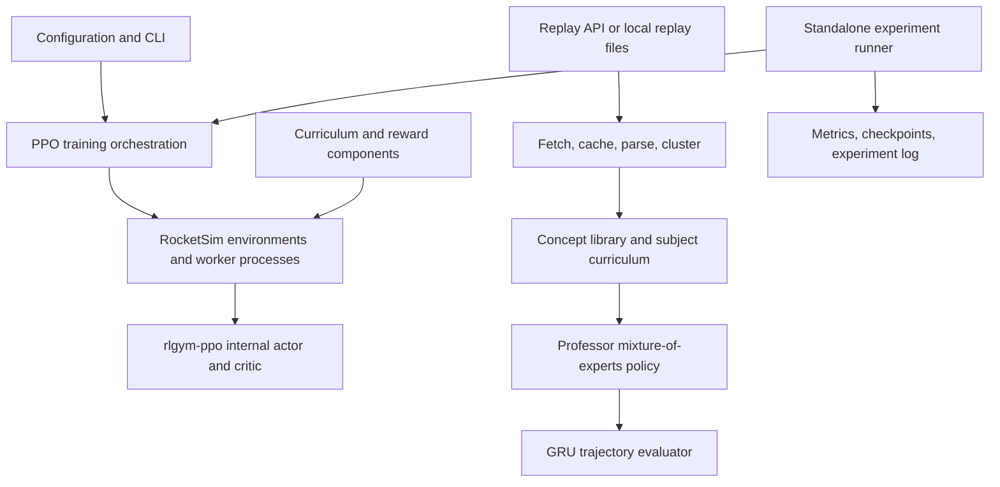

# RLBOTSLOT — Rocket League Reinforcement Learning Research

A Python research project for training Rocket League agents in simulation and
exploring how specialist neural networks, replay-derived behaviors, and automated
experiments can support reinforcement learning.

The repository demonstrates applied machine learning, simulation engineering,
asynchronous data pipelines, numerical programming, and experiment tooling. It
combines a configurable RocketSim/rlgym-ppo training path with separately
implemented mixture-of-experts and trajectory-evaluation components.

**Status:** experimental research software. Component implementations are present;
several training integrations remain incomplete. No competitive rank, measured
win-rate improvement, or GPU speedup is claimed.

## Project highlights

- **Simulation and reinforcement learning:** configurable worker processes,
  PPO hyperparameters, a 90-action discrete control table, custom observations,
  state initialization, termination conditions, and a five-stage curriculum.
- **Neural network architecture:** a PyTorch mixture-of-experts actor with noisy
  top-2 routing, eight initially active concepts, up to 64 preallocated expert
  slots, auxiliary load balancing, and a separate value network.
- **Trajectory evaluation:** a GRU-based debate module that scores supporting and
  opposing interpretations of a concept and produces shaping signals and a loss.
- **Replay analysis:** asynchronous HTTP ingestion, request throttling, SQLite
  download deduplication, trajectory parsing, HDBSCAN behavior clustering, heuristic
  subject naming, and behavior-cloning components for specialist initialization.
- **Experiment automation:** hypothesis generation, configuration snapshots and
  mutations, budgeted training attempts, metric-based acceptance decisions,
  checkpoint promotion or rollback, and structured JSONL experiment records.
- **Performance tooling:** standalone utilities for batched inference, memory-mapped
  experience storage, mixed precision, optional compilation, and profiling.

## Technical skills demonstrated

| Area | Implementation evidence | Engineering skills |
| --- | --- | --- |
| Reinforcement learning | [`engine/`](engine/), [`rewards/`](rewards/), [`config.py`](config.py) | PPO configuration, reward shaping, discrete action design, curriculum scheduling, simulation lifecycle |
| Deep learning | [`professor/`](professor/), [`models/`](models/) | PyTorch modules, sparse expert routing, recurrent sequence models, categorical policies, value estimation, tensor operations |
| Unsupervised and imitation learning | [`replay_system/clusterer.py`](replay_system/clusterer.py), [`imitation_learner.py`](replay_system/imitation_learner.py) | Feature extraction, density-based clustering, behavior cloning, concept registration and pruning |
| Data engineering | [`replay_system/fetcher.py`](replay_system/fetcher.py), [`parser.py`](replay_system/parser.py) | Async HTTP, rate limiting, SQLite, caching, trajectory transformation |
| Experiment systems | [`autoresearch/`](autoresearch/) | Controlled configuration changes, checkpoint lifecycle, experiment budgets, acceptance criteria, structured logging |
| Performance engineering | [`optimizations/`](optimizations/) | NumPy memory mapping, inference batching, precision selection, compilation fallbacks, profiling |
| Software engineering | [`tests/`](tests/), [`train.py`](train.py), [`scripts/`](scripts/) | Modular Python, command-line interfaces, component testing, configuration management, shell tooling |

**Core stack:** Python, PyTorch, NumPy, RocketSim, RLGym, rlgym-ppo,
HDBSCAN, scikit-learn, asyncio/aiohttp, SQLite, pytest, Bash, and optional
Weights & Biases logging. Replay parsing uses an optional carball integration.

## Architecture



The separation between the PPO learner and the Professor policy is intentional in
this diagram: the current learner wrapper constructs rlgym-ppo's internal MLP
policy and does **not** train the custom Professor policy through PPO. The debate
module is implemented and exercised independently; its outputs are not yet
connected to the production PPO update.

### Design decisions

**Bounded expert capacity.** The concept library activates and masks preallocated
expert slots. New concepts can be represented without rebuilding the policy's
module structure. Routing combines selected expert logits and exposes an
auxiliary loss to discourage concentration on a single expert.

**Curriculum-specific rewards.** Reward components separate ball interaction,
scoring, positioning, boost usage, aerial behavior, and related skills. A scheduler
selects stage-specific weights and can serialize its state for checkpoints.

**Replay discovery outside the main loop.** Replay fetching and analysis run in a
background pipeline, with results drained by training orchestration. A local
SQLite index tracks previously downloaded replays; it is generated at runtime.

**Recoverable experiments.** The experiment runner snapshots configuration and
separates baseline and candidate checkpoints. It promotes accepted candidates
and restores configuration for rejected experiments. Its time cap is checked
between learner iterations, so it is not a hard process timeout.

## Current limitations and research roadmap

- `engine/worker_pool.py` currently selects CPU for the PPO learner. Automatic
  device selection elsewhere does not establish end-to-end GPU training support.
- The main loop currently supplies placeholder goal-rate/reward metrics. Real
  evaluation signals must be wired in before curriculum progress or policy
  improvements can be assessed reliably.
- The Professor policy, debate loss, and performance utilities need further
  integration and end-to-end evaluation with the PPO update path.
- Automated experiments currently run in a separate mode. Interleaving them with
  the main training loop and quantum-inspired search remain proposals.
- Dependency ranges are not a reproducible environment lock. Simulation, replay
  parsing, and accelerator compatibility need validation for the chosen platform.

[`docs/PLAN.md`](docs/PLAN.md) is a historical proposal. Its throughput numbers,
speedups, hardware workarounds, and algorithmic expectations are unverified
targets, not benchmark results or current installation guarantees.

## Setup and validation

Create an isolated environment and install the dependencies appropriate to your
platform. The full research stack is declared in `requirements.txt`:

```sh
git clone https://github.com/KillianM00/RLBOTSLOT.git
cd RLBOTSLOT
python3 -m venv .venv
source .venv/bin/activate
python -m pip install -r requirements.txt
```

For component tests and a synthetic smoke check without the simulator or replay
parser, a smaller environment can use:

```sh
python -m pip install torch numpy pytest hdbscan scikit-learn
python -m pytest tests -q
python train.py --dry-run --disable-replays --disable-wandb --n-workers 1
```

The dry run exercises neural-network and reward components with synthetic inputs.
It does not run a RocketSim match or establish training performance. The scripts
under `scripts/` contain hardware-specific setup examples; review them before use.

Validation on November 3, 2026: the CPU synthetic smoke check passed. The existing
component suite returned **46 passed, 5 failed**. Failures concern inactive-expert
masking expectations and ball-control, goal/concede, and shot-reward checks.
These are unresolved test/implementation mismatches; this repository is not
presented as having a passing full test suite.

For replay downloads or external experiment logging, copy `.env.example` to
`.env` and supply your own credentials. Keep `.env`, replay files, the replay
database, checkpoints, and logs out of Git. Disable replays and logging when
those services are unnecessary.

With the full stack installed, the available training modes include:

```sh
python train.py --disable-replays --disable-wandb --n-workers 4
python train.py --autoresearch --autoresearch-experiments 10 \
  --disable-replays --disable-wandb --n-workers 4
```

For reproducible comparisons, record the commit, dependencies, hardware, random
seeds, worker count, timestep budget, evaluation opponents, and resulting metrics.
Use held-out evaluation rather than training reward alone.

## Résumé-ready project description

**RLBOTSLOT | Reinforcement Learning and ML Systems Research**

*Python · PyTorch · RocketSim/RLGym · NumPy · HDBSCAN · SQLite · asyncio*

Developed a modular Rocket League reinforcement-learning research framework
combining simulation-based PPO training orchestration, specialist neural-network
prototypes, replay analysis, and automated hyperparameter experiments.

- Designed a PyTorch mixture-of-experts policy prototype with top-2 routing,
  capacity for 64 experts, concept activation masks, load-balancing loss, and a
  separate value network; implemented a GRU-based trajectory evaluation module.
- Built configurable simulation infrastructure with a 90-action control space,
  custom observations, modular reward shaping, and a five-stage curriculum.
- Implemented an asynchronous replay-analysis pipeline with API throttling,
  SQLite deduplication, trajectory features, HDBSCAN clustering, and
  behavior-cloning components for specialist initialization.
- Created an automated experiment runner with configuration snapshots,
  parameter mutations, checkpoint promotion and rollback, and JSONL experiment
  records; developed profiling and memory-mapped storage utilities.

These bullets describe implemented engineering work. They do not imply a
validated competitive bot, completed PPO/MoE integration, or measured speedup.

## Source map

| Path | Responsibility |
| --- | --- |
| `train.py`, `config.py` | CLI, orchestration, central hyperparameters |
| `engine/`, `rewards/` | Environment construction, controls, curriculum, rewards |
| `models/`, `professor/` | Neural-network components and concept library |
| `replay_system/` | Ingestion, parsing, clustering, imitation learning |
| `autoresearch/` | Hypotheses, experiment execution, evaluation, records |
| `optimizations/` | Batching, memory mapping, precision, compilation, profiling |
| `tests/` | Component tests for policies, routing, concepts, curriculum, rewards |

## Licensing

No project-wide license has been selected for the original code. Dependencies
and third-party replay data retain their own terms. Contact the maintainer before
reuse.
